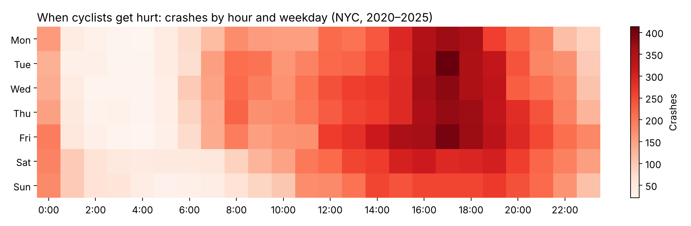
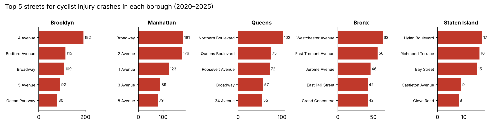

# NYC Cyclist Crash Analysis with PySpark

A PySpark batch job that processes **578K NYC motor vehicle collisions (2020 – Nov 2025)**, isolates the **30,266 crashes that injured or killed a cyclist**, and finds when, where and on which streets they concentrate. Results are written as Parquet and CSV.

A companion to my [NYC Bike Safety Navigator](https://github.com/Darrenlinnn/nyc-bike-safety-navigator), which turns the same crash data into a route-safety web app.

## Key findings

- **Weekday evening commutes are the danger zone.** Weekdays from 3 to 8 pm make up 15% of the week's hours but **28% of cyclist injury crashes**. The single worst hour is around 5 pm on Tuesdays and Fridays.
- **Brooklyn and Manhattan account for 68% of crashes**: 8,761 in Brooklyn and 7,242 in Manhattan.
- **A few corridors stand out:** 4 Avenue in Brooklyn (192), Broadway (181) and 2 Avenue (176) in Manhattan, and Northern Boulevard in Queens (102).
- **No clear improvement:** about 4,800–5,500 cyclist injury crashes a year since 2020, with 18–30 deaths a year. The 2025 figures run only through Nov 21.





| Year | Crashes | Cyclists injured | Cyclists killed |
| --- | --- | --- | --- |
| 2020 | 5,456 | 5,549 | 28 |
| 2021 | 4,885 | 4,944 | 19 |
| 2022 | 4,943 | 5,011 | 18 |
| 2023 | 5,102 | 5,154 | 30 |
| 2024 | 5,076 | 5,138 | 24 |
| 2025 (to Nov 21) | 4,804 | 4,882 | 20 |

## What the Spark job does

1. **Load and clean:** reads the CSV, parses timestamps, casts counts to integers, turns placeholder values ("NaN") into nulls, deduplicates on `collision_id`, and keeps records from 2020 onward.
2. **Filter:** keeps crashes with at least one cyclist injured or killed, and caches that DataFrame for reuse.
3. **Aggregate:**
    - yearly trend
    - hour × weekday counts
    - borough totals
4. **Rank with a window function:** `row_number()` over `partitionBy("borough")` finds the top 5 streets in each borough in one pass.
5. **Write:** saves each result table as **Parquet**, a compressed columnar format built for big data, plus a CSV copy for easy viewing.

> **Window function, in plain words:** it ranks rows *within groups* without collapsing them. Here it means "rank streets by crash count, separately for each borough," so you get each borough's own top 5 instead of one citywide list.

## How to run

```bash
pip install -r requirements.txt        # needs Java 8+ for Spark
python src/crash_analysis.py --input data/bike_crashes.csv --out output
python src/make_charts.py output images
```

The data comes from the public [Motor Vehicle Collisions: Crashes](https://data.cityofnewyork.us/d/h9gi-nx95) dataset on NYC Open Data. See `data/README.md`. On a laptop, the job finishes in under a minute.

**Tools:** PySpark (DataFrames, Spark SQL functions, window functions, caching, Parquet), pandas, matplotlib
